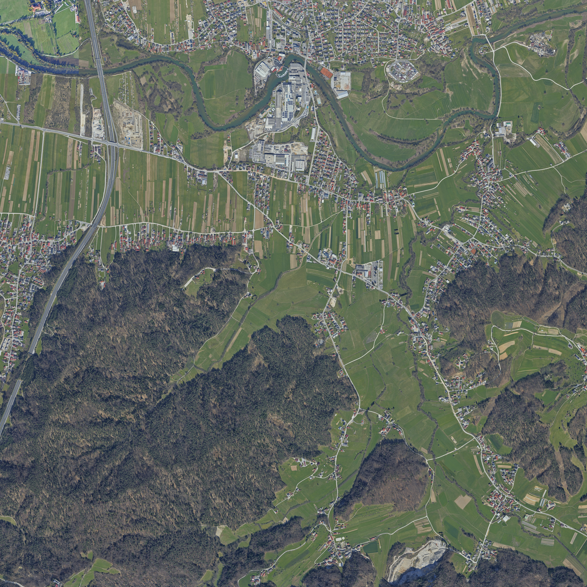

# Battlefield 2 — Slovenia Golovec (`slovenia_golovec`)

[](tests/)
[](https://en.wikipedia.org/wiki/Refractor_2)
[](#license)
[](https://github.com/subsubl/bf2-slovenia-golovec)

An authentic, 1:1 real-world **Battlefield 2** multiplayer level recreating Southeast Ljubljana, the Golovec forested mountain ridge, and the Ljubljanica river valley in Slovenia ($46.046559^\circ\text{ N}, 14.592945^\circ\text{ E}$).

Built with precision geospatial workflows combining **Slovenian Ministry of the Environment & GURS 1 m airborne LiDAR (DMR/D48/GK)**, **GURS normalized Digital Surface Models (nDMP)**, **Ministry of Agriculture land-use polygons (RABA-KGZ)**, and **OpenStreetMap vector geodata**.

Designed for **maximum immersion and authentic physics** while remaining **100% vanilla BF2 compatible and ultra-fast on vintage / budget hardware** (zero custom textures or GPU-crushing shaders required).

---

## 🗺️ Map Overview



- **Combat Area:** $2048 \times 2048\text{ m}$ (4.19 km²) spanning Golovec Ridge, Litijska Valley, Štepanjsko naselje, Fužine Castle, and Vevče/Kašelj.
- **Elevation Range:** $266.75\text{ m}$ (Ljubljanica riverbed) to $451.32\text{ m}$ (Golovec summit).
- **Supported Gamemodes:** Conquest Head-On (16, 32, 64 players) with tanks, APCs, and transport jeeps.
- **Armies:** China (CH) vs. United States (US) / European forces.

---

## 🌟 Key Features

### 1. 1:1 Slovenian Airborne LiDAR Elevation & LOD System
- Exact GURS DMR terrain elevation compiled directly into **Refractor 2's native binary `terraindata.raw`** (46.4 MB).
- **Quadtree Frustum Bounding Boxes:** All 5,461 quadtree nodes mathematically computed from LiDAR minima/maxima to guarantee zero ground clipping or LOD pop-in at any viewing distance.
- Smoothly graded 5-meter foundation pads under hillside buildings so doorways sit flush without buried entrances or floating corners.

### 2. Ljubljanica River & 5 Authentic Bridge Crossings
- **Hydrodynamic Bathymetry:** Carved a 2.75 m deep channel strictly inside the OSM river boundary, normalized to `setSeaWaterLevel 269.50` so 100% of the Ljubljanica is navigable from West to East with zero flooding of Eastern agricultural fields.
- **5 Real-World Bridges:**
  1. **A1 Motorway Bridge** (`highway_bridge_low` multi-span)
  2. **Fužine Castle Bridge** (`lrg_stonebridge`)
  3. **Vevče Bridge** (`woodsteel_bridge` 3-segment)
  4. **Zadvor / Vevče South Bend Bridge** (`lrg_stonebridge`)
  5. **Kašelj / Zalog Bridge** (`woodsteel_bridge` 3-segment)
- Complete with graded approach embankments and seamless road-deck transitions.

### 3. OpenStreetMap & RABA-KGZ Detailmaps & Ground Physics
- **Multi-Material Blending:** Baked asphalt roads (`motorway`, `secondary`, `tertiary`), gravel trails, steep Golovec limestone crags, and agricultural fields into 64 DXT1 terrain detailmaps (`Detailmaps/tx*_1.dds` & `LowDetailmaps/tx*.dds`).
- **Vehicle & Footstep Physics (`HeightmapPrimary.mat`):** Realistic surface friction and dust/splash audio effects when driving or sprinting across tarmac, dirt, grass, gravel, or water.

### 4. GURS nDMP Canopy & 3-Zone Forest Overgrowth
- Tree and bush canopies classified directly from the GURS LiDAR normalized canopy model (`Overgrowth.raw`):
  - **Zone 1 (Scrub / Bushes 1.5–4.5 m):** Hedgerows and field margins (`nc_medbush01`, `nc_leafybush01`).
  - **Zone 2 (Woods Edge 4.5–11.5 m):** Mixed riparian birch and oak along the Ljubljanica riverbanks.
  - **Zone 3 (Forest Interior >= 11.5 m):** Dense mature Golovec pine, beech, and oak forest.
- **9,114 Solid LiDAR Tree Trunks (`OvergrowthCollision.con`):** Full soldier and vehicle collision cover across all 256 map patches.
- **Shoreline Cattails & Reeds (`Undergrowth.raw`):** Lush reeds and riverbanks within 3.5 m of the water.

### 5. Curated Slovenian Landmarks & Infrastructure
- **MHE Fužine Hydroelectric Dam & Weir:** Powerhouse station and weir overflow crest.
- **Grad Fužine (Fužine Castle):** Stone perimeter courtyard walls overlooking the river bend.
- **Golovec Ridge Radio Towers & Antennas:** High-altitude communication masts on the crest.
- **Vevče Paper Mill:** Industrial smokestack, silos, and factory warehouses.
- **Power Grid & Road Lighting:** High-voltage transmission towers, utility poles, and street lighting along the A1 corridor.

### 6. 3D Positional Spatial Audio & Interactive Wildlife
- **Positional Soundscapes (`AmbientObjects.con`):** Rushing weir rapids at MHE Fužine, turbine hum, continuous water lapping under all 5 bridges, ridge wind on Golovec, and village ambience.
- **Dynamic Forest Bird Flocks:** 10 interactive bird triggers (`Trigger_birds*`) that startle and scatter into the air when players sprint through forest clearings or riverbanks.

### 7. Strategic 6-Flag Landmark Conquest Layout
- Expanded combat boundary ($-950\text{ m}$ to $+950\text{ m}$) ensuring all 5 river crossings are in play:
  - **🚩 CP 1: `CP_EU_BASE`** (Golovec Ridge South Base) — Tanks, APCs, Fast Attack Jeeps
  - **🚩 CP 2: `CP_GOLOVEC_PASS`** (Hrušica / Litijska Cesta Pass) — APCs, Jeeps
  - **🚩 CP 3: `CP_STEPANJSKO_A1`** (Štepanjsko & A1 Motorway Bridge) — Tanks, Jeeps
  - **🚩 CP 4: `CP_GRAD_FUZINE`** (Fužine Castle & Weir Crossing) — APCs, Jeeps
  - **🚩 CP 5: `CP_ZADVOR_SOUTH_BEND`** (Zadvor / South River Bend) — APCs, Jeeps
  - **🚩 CP 6: `CP_MEC_BASE`** (Vevče / Kašelj North Bank Base) — Tanks, APCs, Jeeps

---

## 📂 Repository Structure

```text
├── levels/slovenia_golovec/        # Ready-to-play level archives
│   ├── client.zip                  # Terrain mesh, textures, minimap, lightmaps, shaders
│   ├── server.zip                  # Heightmaps, physics materials, statics, overgrowth, CPs
│   └── Info/                       # Menu thumbnails, loadscreen art, level description
├── scripts/
│   └── compile_slovenia_golovec.py # Master automated compilation pipeline
├── docs/
│   ├── PROJECT_REALITY_MAPPING_GUIDE.md  # PR mapping standards & reference specs
│   └── project_reality/                  # PR official documentation pages
├── tests/                          # 225 pytest verification suites
├── Heightmap.raw                   # Full-resolution 2049x2049 16-bit LiDAR DEM
└── ColorMap_preview.png            # 4096x4096 aerial orthophoto
```

---

## 🚀 Installation & Play

1. **Locate your Battlefield 2 Levels Directory:**
   - **Linux / Wine:** `~/.wine/drive_c/Program Files (x86)/EA Games/Battlefield 2/mods/bf2/Levels/`
   - **Windows:** `C:\Program Files (x86)\EA Games\Battlefield 2\mods\bf2\Levels\`

2. **Copy the Level Folder:**
   ```bash
   mkdir -p "/path/to/Battlefield 2/mods/bf2/Levels/slovenia_golovec"
   cp -r levels/slovenia_golovec/{client.zip,server.zip,Info} "/path/to/Battlefield 2/mods/bf2/Levels/slovenia_golovec/"
   ```

3. **Clear the Shader Cache (Recommended after updates):**
   - Delete all files inside `Documents/Battlefield 2/mods/bf2/cache/`.

4. **Launch the Game:**
   - Select **Multiplayer** (Create Local) or **Singleplayer**, choose **Slovenia Golovec (4km)**, and deploy!

---

## 🛠️ Automated Compilation & Testing

To recompile the map from source geodata:
```bash
python3 scripts/compile_slovenia_golovec.py
```

To run the automated test suite (verifying terrain headers, quadtree geometry, normals, and `.con` syntax):
```bash
pytest -v
```

---

## 📄 License & Data Attributions

- **Elevation Data:** Republic of Slovenia, Ministry of Natural Resources and Spatial Planning, Surveying and Mapping Authority of the Republic of Slovenia (GURS / ARSO) — LiDAR DMR & nDMP via [clss.si](https://clss.si/).
- **Vector Geodata:** © [OpenStreetMap](https://www.openstreetmap.org/) contributors, available under the Open Database License (ODbL).
- **Land-Use Data:** Ministry of Agriculture, Forestry and Food of the Republic of Slovenia (RABA-KGZ).
- **Code & Map Scripts:** Released under the MIT License.
